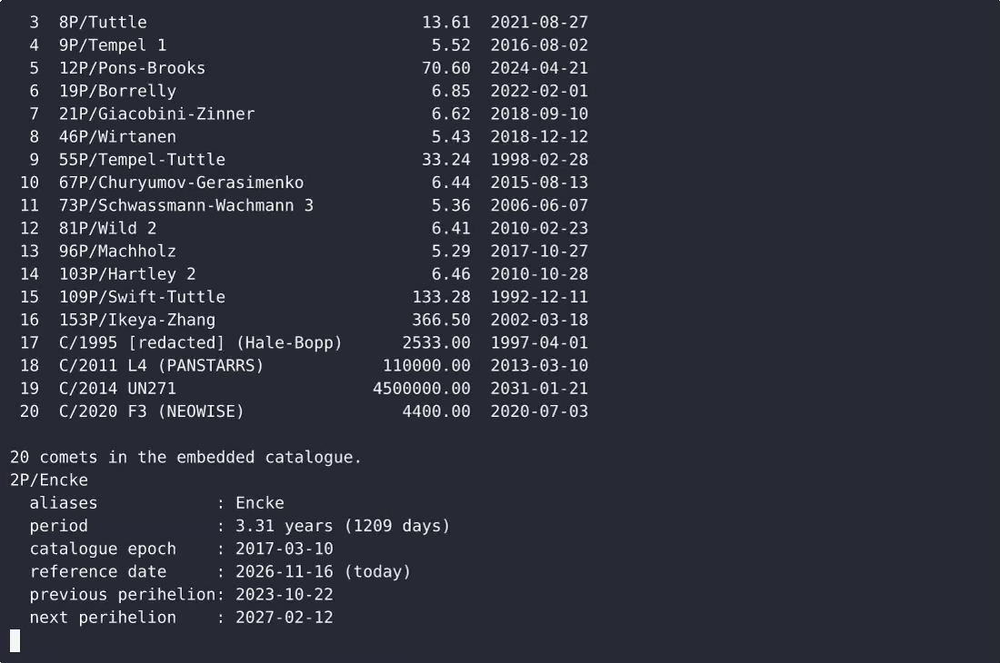

# CometTrain — complete Full-stack app command-line tool example app

Want to run your own command-line tool without paying for SaaS? **CometTrain** is a free, Apache-2.0-licensed Full-stack app project that you can clone and self-host today. CometTrain is a single-file, standard-library-only Python CLI for comet apparitions: it ships a built-in catalogue of ten well-known comets, prints their orbital periods and last-perihelion epochs as a clean fixed-wid…. Every CometTrain feature — every screen, every seed record — is here. [Open CometTrain on cenius.ai](https://cenius.ai/marketplace/p/comettrain?ref=gh&utm_campaign=comettrain-webapp) to modify it without writing code.


[](LICENSE)  [](https://cenius.ai)

[](https://cenius.ai/marketplace/p/comettrain?ref=gh&utm_campaign=comettrain-webapp)

> **▶ [Open & edit in cenius.ai](https://cenius.ai/marketplace/p/comettrain?ref=gh&utm_campaign=comettrain-webapp)** — one click to an editable workspace: describe changes in plain English, get an instant preview, one-click deploy and host. Modifications made on the platform come with full rebrand & relicense rights.

_Local clone? See [Quick start](#quick-start) below. cenius.ai is the zero-setup path._

## Demo


▶ **[Full demo walkthrough](https://cenius.ai/marketplace/p/comettrain?ref=gh&utm_campaign=comettrain-webapp)** — watch it on the project page · [download MP4](.github/media/demo.mp4)

## Screenshots



## Features

- Orbital period table lookup
- Perihelion date entry
- Next apparition calendar
- Input validation, help and exit codes

## Quick start

```bash
./install.sh   # installs dependencies + seeds demo data
```

See [`INSTALL.md`](INSTALL.md) for full setup and usage instructions.

## Architecture

Open the repo and you'll find a complete Full-stack app application (13 files). Top-level layout: `demo/`, `docs/`, `tests/`. `install.sh` wires up dependencies and loads seed records; after it runs the app has real data to show. For environment-specific setup, see [`INSTALL.md`](INSTALL.md).

## Usage guide

Every command is read-only and offline. Run them from the project directory as
`python3 comettrain.py <command>`; the output below is verbatim.

### `list` — the catalogue

```bash
$ python3 comettrain.py list
CometTrain catalogue - 20 comets

#  #  Name                        Period (yr)  Catalogue epoch
---  --------------------------  -----------  ---------------
  1  1P/Halley                         75.32  1986-02-09
  2  2P/Encke                           3.31  2017-03-10
  3  8P/Tuttle                         13.61  2021-08-27
  ...
 20  C/2020 F3 (NEOWISE)             4400.00  2020-07-03

20 comets in the embedded catalogue.
```

The period is the nominal orbital period in years; the epoch is one known
perihelion that anchors the orbit. Both columns stay aligned for every name and
every line fits inside 80 columns.

### `show <query>` — one comet in detail

`show` takes a case-insensitive substring of a name **or** an alias:

```bash
$ python3 comettrain.py show encke
2P/Encke
  aliases            : Encke
  period             : 3.31 years (1209 days)
  catalogue epoch    : 2017-03-10
  reference date     : 2026-11-16 (today)
  previous perihelion: 2023-10-22
  next perihelion    : 2027-02-12
```

Aliases are matched too, so `show "halley's comet"` finds `1P/Halley`. An ambiguous
query lists every match with its period and epoch so you can refine:

```bash
$ python3 comettrain.py show tempel
2 comets match 'tempel':

  9P/Tempel 1          5.52 yr  2016-08-02
  55P/Tempel-Tuttle   33.24 yr  1998-02-28

_Full guide: [`USAGE.md`](USAGE.md)_

## FAQ

### What does it take to self-host CometTrain?

Clone this repository and run `./install.sh`, then start the app as described in [`INSTALL.md`](INSTALL.md). CometTrain is fully self-hostable — no external services are required to try it.

### What if I want to add features to CometTrain without coding?

Non-developers can use [cenius.ai](https://cenius.ai/marketplace/p/comettrain?ref=gh&utm_campaign=comettrain-webapp) to make changes. Describe your goal in everyday language and the platform delivers an updated, ready-to-run project — zero coding on your part.

### How do I customise CometTrain's branding?

Rebranding is straightforward under the MIT license — change what you want in the source. Or [open it on cenius.ai](https://cenius.ai/marketplace/p/comettrain?ref=gh&utm_campaign=comettrain-webapp): the platform handles the changes and grants full rebrand rights on the result.

### Which technology stack does CometTrain use?

Full-stack app end-to-end. Every file you need to run the app is here in this repository — code, configuration, seed data. Highlights include next apparition calendar.

### What license does CometTrain use?

Yes — it ships under the Apache-2.0 license, which permits commercial use, modification and redistribution. The full text is in [LICENSE](LICENSE).

## License & rebranding

Released under the [Apache License 2.0](LICENSE) (© 2026 Cenius AI) — free for personal and commercial use. The Cenius name/logo are trademarks (see NOTICE).

**Need a customized version?** [Remix this app on cenius.ai](https://cenius.ai/marketplace/p/comettrain?ref=gh&utm_campaign=comettrain-webapp) — modifications made on the platform come with **full rebrand & relicense rights** over your derivative.

## Built with cenius.ai

This entire application — code, design, seeded demo data — was generated on **[cenius.ai](https://cenius.ai)** from a plain-English description.

- 🚀 [Build your own app on cenius.ai](https://cenius.ai)
- 🎛️ [Remix CometTrain on the marketplace](https://cenius.ai/marketplace/p/comettrain?ref=gh&utm_campaign=comettrain-webapp) — open it in a workspace, prompt for changes, and ship your own version.

More open-source apps: [the Cenius-ai catalog](https://github.com/Cenius-ai) · [showcase index](https://github.com/Cenius-ai/showcase)
